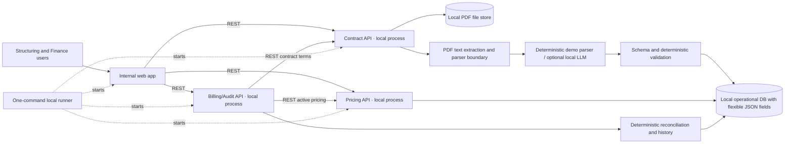

# Apollo / Wheels – AI Product & Developer Partner Assessment
## Complete project context, requirements, assumptions, decisions and open questions

**Current implementation references:** detailed field/database/sample explanations, the assumptions register, and the LLM model trade-off now live under [`docs/`](docs/README.md). Keep those reference files updated alongside this interview context.

**Document purpose:** Single source of truth for the Wheels assessment and the collaborative build.  
**Last updated:** 5 November 2026  
**Status:** Requirements captured from the interview briefing, the supplied assessment slide and follow-up discussion.  
**Important:** This document distinguishes (1) facts explicitly stated by the interviewer, (2) the candidate's understanding/proposed approach, and (3) unanswered questions. Do not present an assumption or proposed enhancement as an implemented or confirmed business requirement.

---

# 1. Assessment brief and expected outcome

The candidate is being assessed for an AI Product / Developer role in the Wheels / Apollo Enterprise Solutions context.

The interviewer wants a **working product / MVP**, not merely a conceptual proof of concept, chatbot, document summariser or presentation about what could be built. The interviewer wants to see how the candidate thinks, makes decisions, owns an ambiguous problem, chooses tools and delivers a usable working demonstration.

## 1.1 Time and format

- The interviewer initially described a three-day build window, with an additional day also mentioned as available.
- The follow-up presentation / discussion is scheduled for Thursday (as stated during the conversation).
- The final discussion is expected to be approximately 30 minutes.
- A local demonstration on the candidate's machine is acceptable; the interviewer explicitly confirmed this.
- The interviewer expects a working prototype / MVP and a presentation deck of approximately **four to five slides**.
- The interviewer said the presentation should cover:
  1. Problem statement / understanding.
  2. Approach.
  3. Assumptions made.
  4. Architecture.
  5. Demo (the interviewer may prefer to move to the demo early).
- The interviewer mentioned test cases, including functional and integration tests.
- High-level design / architecture is sufficient; the interviewer said low-level design is not required.
- Architecture diagrams are expected/useful. A sequence diagram or dry-run diagram can be included if useful, but detailed diagram expectations have not been fully specified.
- The final presentation should include a live working demonstration and a concise explanation of key decisions.

## 1.2 Assessment criteria stated by the interviewer

The interviewer explicitly highlighted these assessment dimensions:

### A. Attitude and ownership
- Does the candidate own the problem?
- Does the candidate ask useful questions while understanding the problem?
- Does the candidate think through the problem independently?
- Does the candidate make reasonable assumptions and keep moving?
- Does the candidate avoid stalling when all details, data or resources are not provided?
- Does the candidate consider future scale and extensibility?

### B. Storytelling and communication
- Can the candidate explain complex concepts in simple language?
- Can the candidate communicate at executive level?
- Can the candidate explain technical decisions and business value clearly?
- The interviewer gave the example of explaining AI and Machine Learning to a six-year-old.

### C. Technical depth and tool choice
- Can the candidate explain why a particular OCR tool, LLM or other technology was selected?
- Can the candidate explain why one tool was chosen over alternatives?
- Can the candidate discuss limitations and trade-offs?
- The interviewer wants to understand the candidate's reasoning, not just see a list of technologies.

### D. MVP quality and working demo
- The application must work.
- The interviewer does not want a demo where the candidate says a feature does not work but explains what it was intended to do.
- The product should be polished enough to use and demonstrate.
- A reasonable level of accuracy is expected, but the interviewer explicitly said **100% accuracy is not expected**. The important thing is the approach and the ability to identify issues systematically.

## 1.3 Use of AI and synthetic data

The interviewer explicitly permitted:
- Using AI tools during development.
- Generating synthetic documents.
- Generating synthetic data.
- Making reasonable assumptions where real information is not supplied.
- Experimenting creatively.

The interviewer wants to assess how the candidate makes sensible assumptions and continues delivering rather than waiting for every detail to be provided.

---

# 2. Business and organisational context

## 2.1 Wheels business scale (figures stated by interviewer)

The interviewer described Wheels as:
- Approximately **1.1 million vehicles managed**.
- Approximately **70%** of the vehicles are owned and serviced by Wheels itself.
- The interviewer described this as approximately **750,000 Wheels-owned vehicles**.
- The remaining approximately **30%** are owned by end clients.
- Approximately **US$9 billion** in assets under management.
- Presence in **59 countries**, including Europe, attributed in part to mergers and acquisitions.
- More than **100 Fortune 500 clients**.

These figures are interview-provided background and are not independently verified in this document.

## 2.2 Apollo / AES organisational explanation

The interviewer explained a three-tier structure:

1. **Tier 1 – Apollo Global Management:** Parent organisation, headquartered in New York, described as having approximately 3,000 employees and more than US$1.1 trillion in assets under management. The interviewer described private equity and private credit as its two primary products.
2. **Tier 2 – Platform companies:** The interviewer described 22 portfolio/platform companies across multiple sectors. Wheels is the platform company in fleet management and leasing in the portfolio described.
3. **Tier 3 / shared capability – AES (Apollo Enterprise Solutions):** An internal capability organisation supporting platform companies in areas such as operations, AI, technology, data analytics, business excellence and core finance, including mergers and acquisitions.

The interviewer said AES was formed in November 2025 to build internal capabilities and reduce dependency on external consulting providers. The interviewer described AES as a shared utility that can support multiple Apollo platform companies. This is organisational background, not a feature requirement for the prototype.

The interviewer said they were among the first employees involved in establishing the Mumbai office. At the time of the discussion, they described approximately 55 employees onboarded across Mumbai and Bangalore, with approximately 30 more offers rolled out / expected to join in November or December.

---

# 3. The supplied assessment slide

The user supplied a photograph of the PowerPoint slide titled:

**“AI Product / Developer Partner Activity”**  
Subtitle: **“Deeper Dive – Contracts / Agreements”**

The slide is included alongside this Markdown file as:

`AI_Related_Test_Business_Case.jpg`

## 3.1 Text and content visible on the slide

The slide states that:
- Wheels has two master contracts to set up clients and bill them on a regular basis:
  - Master Service Agreement.
  - Master Lease Agreement.
- The process of receiving signed and executed documents from clients is manual and bespoke.
- Documents are forwarded via email to the finance team for manual review and system setup for onward billing.
- Documents range between approximately **16–20 pages** on the slide and are mostly PDF.
- Important paragraphs/sections in the contracts are crucial for interpretation and billing and cut across the services offered by Wheels.
- The slide lists the services:
  - Fuel
  - ITR
  - MAP
  - RR
  - Toll
  - Violation
  - Collision
  - Insurance
  - Mileage + Logging
  - Telematics
  - Rentals
  - MVR + Safety
  - Remarketing
- Contracts have calculations and/or billing information for any or all services.
- Manual setup creates risks:
  - Incorrect billing, including overbilling and underbilling.
  - Missed billing for services provided.
  - Delays.

The slide asks the candidate to prepare a presentation and discussion on how to solve the problem and provide solutions to envision a strategic future state powered by AI. The discussion is to take place within three days, with a follow-up meeting arranged by HR and the Wheels team.

**Page-count note:** Earlier verbal discussion described documents as around 10–30 pages; the slide appears to say 16–20 pages. This remains an open clarification. Do not silently reconcile the two statements.

---

# 4. Contract types and their business meaning

Wheels receives two major legal contract types from clients. The interviewer described both as legal documents that are binding and applicable in a court of law.

## 4.1 Master Service Agreement (MSA)

- The MSA captures the list of services the end client has subscribed to receive from Wheels.
- A client may select some or all of the services offered.
- The selected services and contractual terms are captured in the MSA.
- The interviewer gave an example of a client with 20,000 vehicles selecting seven services.
- The services selected affect client onboarding and billing setup.
- The MSA may contain important clauses, calculations and billing information relating to the selected services.

## 4.2 Master Lease Agreement (MLA)

- The MLA is applicable where a lease is in place.
- The interviewer explained the distinction between a lease and rental as follows: a lease may provide an option to own the vehicle at the end of the lease, whereas a rental does not normally provide that ownership option.
- The vehicle may be owned by Wheels or by the manufacturer; the interviewer explicitly clarified that ownership can vary.
- The MLA can capture:
  - Number of leased vehicles.
  - Lease duration / time period.
  - Vehicle make.
  - Vehicle model.
  - Engine type.
  - Price, usually monthly, sometimes quarterly.
- If a client owns all vehicles and has no leased vehicles, an MLA may not be applicable.
- The interviewer gave an example of a 20,000-vehicle fleet with 15,000 owned vehicles and 5,000 leased vehicles.

## 4.3 Contract lifecycle before the current process

The interviewer described the negotiation lifecycle:
1. Wheels prepares and sends a draft agreement to the client.
2. The client and/or their legal team reviews it.
3. The client sends comments / negotiation changes.
4. The draft moves back and forth several times.
5. The parties eventually finalise the agreement.
6. The client signs and dates the final agreement.
7. The client emails a scanned / executed copy to Wheels and may also send the original physical copy for records.

**Scope boundary:** The interviewer explicitly said that building a client-facing contract negotiation portal is not the current focus. The requested prototype is an internal standalone tool that processes manually uploaded documents.

---

# 5. Wheels services listed in the slide

The slide lists the following 13 services:

| # | Service as written in slide | Full form / explanation confirmed? |
|---:|---|---|
| 1 | Fuel | No further detail confirmed |
| 2 | ITR | Interviewer expanded this as Initial Title Registration |
| 3 | MAP | Not confirmed |
| 4 | RR | Not confirmed |
| 5 | Toll | No further detail confirmed |
| 6 | Violation | No further detail confirmed |
| 7 | Collision | No further detail confirmed |
| 8 | Insurance | No further detail confirmed |
| 9 | Mileage + Logging | No further detail confirmed |
| 10 | Telematics | No further detail confirmed |
| 11 | Rentals | No further detail confirmed |
| 12 | MVR + Safety | Full form not confirmed |
| 13 | Remarketing | No further detail confirmed |

**Important:** Do not invent or guess the full forms of MAP, RR or MVR. Ask the user/interviewer if needed.

The interviewer said a client may subscribe to any or all services, and the contract may include calculations and/or billing information for any or all of them.

---

# 6. Current business process and pain points

## 6.1 Current manual process

The interviewer described this process:

1. Wheels and the client negotiate an agreement through multiple draft/review cycles.
2. Wheels sends the final draft to the client.
3. The client reviews and signs/dates the agreement.
4. The client emails a scanned / executed copy to Wheels and may also send the original physical copy.
5. Wheels' onboarding / sales team forwards the received documents by email to the finance team.
6. Finance manually reviews each page and clause.
7. Finance identifies subscribed services and interprets the relevant contractual information.
8. Finance manually configures the pricing system / Pricing Manager with details such as service, vehicle counts, price, billing frequency and other billing terms.
9. Once the client is live, the configuration supports onward billing in subsequent billing cycles.

## 6.2 Document characteristics

- Documents are mostly PDFs.
- The slide says approximately 16–20 pages.
- Earlier verbal discussion said approximately 10–30 pages.
- Documents contain important paragraphs and sections that affect service interpretation and billing.
- Documents may contain tables, schedules, clauses and calculations. Whether every type must be supported is not yet confirmed.
- Whether PDFs are digitally generated, scanned or both is not yet confirmed.

## 6.3 Business problems

The interviewer identified three principal risks:

### A. Incorrect billing
Manual interpretation or data entry may cause:
- Overbilling.
- Underbilling.
- Incorrect rates / percentages / decimal placement.

The interviewer gave an example of entering 0.03 instead of 0.3, or 3 instead of 0.3.

### B. Missed billing
A service may be provided to the client but not configured in the billing system, causing the service not to be billed.

### C. Audit delays
The process is manual, document intensive and paper intensive. Annual audit work can be delayed.

The product should help reduce manual work, billing errors, missed billing and audit delays.

---

# 7. Confirmed product scope and user experience

The interviewer explicitly wants a proper working tool. The user and interviewer discussed two major product areas.

## 7.1 Module A – New contract processing, extraction and pricing setup

This is the primary workflow for newly executed contracts.

### User experience explicitly described by interviewer

- User manually uploads the contract document.
- The original PDF appears on the **left-hand side** of the application.
- The user can scroll through the original document.
- Extracted values appear on the **right-hand side**.
- Hovering over an extracted field should highlight the corresponding section/source in the original document.
- Each extracted field should display a confidence score.
- The user should be able to edit extracted values.
- Either a Structuring or Finance user may upload the document. Structuring may edit extracted contract details; Finance may view those details read-only and enter/edit pricing.
- One Finance user initiates/enables pricing; a different Finance user must approve it before activation (four-eyes check).
- After the second-person approval, approved information should be sent through an API to the **Pricing Manager** system (mock service in the POC unless real access is provided) and pricing should be activated/configured.
- Support a notification/output action after the relevant workflow step: a user-triggered send button and/or configurable automatic delivery to configured email addresses or a website/endpoint. Exact behavior and recipient settings are open.
- The interface should make it clear that processing has started / completed and that the API submission has succeeded or failed. Status display is a sensible implementation requirement, though exact status states have not been specified.

### Important scope boundaries

- Current tool is internal only.
- Client users will not use this tool at this stage.
- A client-facing contract negotiation portal is not in scope.
- The immediate prototype is a standalone product with manual document upload.
- In a future state, the tool could connect to an existing contract repository and systematically retrieve documents instead of requiring manual upload.
- Future repository integration could support bulk / mass upload and mass extraction.
- Repository integration is not the immediate MVP focus.
- Review/edit/submit interaction is required, but the responsible role is not yet defined. Do not attribute extraction edits or pricing setup changes to Finance until the Finance/Structuring permissions are clarified.

## 7.2 Module B – Existing-client audit and discrepancy detection

The interviewer explicitly requested a separate view for existing clients.

The key comparison is:

**Contract vs Pricing Setup vs Billing**

The interviewer wants the system to proactively show:
- Which clients have discrepancies.
- Which services each client has subscribed to.
- Which one or two services have issues.
- Whether services are missing from pricing setup.
- Whether pricing is missing or incorrect.
- Whether subscribed services are not billed.
- Whether the tool can pinpoint the issue.

The interviewer described this as a dashboard / page view for existing-client audit. He wants the candidate to think creatively about how to represent services and discrepancies.

The interviewer said:
- Existing client data may be available.
- Comparing contract data with pricing setup and billing data is possible.
- This is an important extension of the product.
- 100% accuracy is not expected from the prototype.
- The interviewer wants to see a systematic / scientific approach to identifying discrepancies.

### Candidate's intended interpretation

For each client and service, compare:
1. Contractual entitlement: what the agreement says should be provided and charged.
2. Pricing setup: what has been configured in Pricing Manager.
3. Actual billing: what has been billed.

Potential discrepancies:
- Service exists in contract but is absent from pricing setup.
- Service exists in contract and pricing setup but is missing from billing.
- Price in setup differs from contract.
- Actual billed amount differs from expected amount.
- Quantity / vehicle count / driver count differs.
- Billing frequency or billing date differs.
- Pricing unit differs (per vehicle, per driver, fixed amount, percentage, basis points).
- Service is configured or billed but not supported by the contract.
- Contract amendment is newer than setup/billing information.

These are proposed comparison rules. Exact business rules, proration, discounts, taxes, effective-date handling, rounding and calculation conventions remain to be confirmed.

### Suggested dashboard information (proposed)

- Client name / identifier.
- Agreement identifier and version.
- Number of contracted services.
- Number of configured services.
- Number of billed services.
- Discrepancy count.
- Affected service and field.
- Contract value vs pricing setup value vs billed value.
- Potential financial impact, if sufficient data is available.
- Evidence/source clause/page.
- Severity / confidence.
- Recommended next action.

Do not claim that financial impact can be calculated accurately until required billing data and calculation rules are known.

## 7.3 Future functionality – contract repository and bulk extraction

The interviewer described a future integration:
- There is an existing repository/module where contracts are stored.
- The new tool could be connected to it.
- Instead of manual uploads, the tool could systematically retrieve contracts.
- It could support mass upload and mass extraction.

This should be described as a future integration path, not a current must-have feature.

---

# 8. Fields and contractual information to extract

The interviewer explicitly mentioned these data elements:

- Service.
- Number of vehicles.
- Amount / price.
- Price may be expressed in dollars, basis points or percentage.
- Billing period / frequency.
- Billing date, such as the 20th of the month, first of the month or last day of the month.
- For driver-related services, number of drivers.

The MLA explanation also mentioned:
- Number of leased vehicles.
- Lease time duration.
- Vehicle make.
- Vehicle model.
- Engine type.
- Monthly or quarterly price.

### Candidate-proposed additional fields (not yet confirmed as mandatory)

- Client name and client ID.
- Agreement ID / contract number.
- Agreement type (MSA / MLA).
- Contract effective date.
- Contract expiry date.
- Service start and end dates.
- Currency.
- Pricing unit / pricing basis.
- Minimum commitment.
- Discounts / tiers.
- Source page and clause.
- Extraction confidence.
- Review status.
- Version / amendment identifier.

These are reasonable candidates for a schema, but mark them as assumptions until confirmed.

---

# 9. AI and engineering approach – proposed, not mandated

The interviewer has not mandated a specific technology stack, model, OCR engine or database. Tool selection and rationale are part of the assessment.

A sensible proposed approach:

## 9.1 Document ingestion
- Accept PDF upload.
- Detect whether the PDF contains extractable digital text or is scanned/image-based.
- Use native PDF text extraction for digital PDFs.
- Use OCR for scanned PDFs.
- Preserve page boundaries and text positions so evidence can be linked to the original PDF.
- Extract tables / schedules if present and relevant.

## 9.2 Structured extraction
- Define a schema for contract-level, service-level, pricing and lease details.
- Use an LLM to interpret contractual clauses and map them to structured fields.
- Ask the model to return source evidence for each field: page number, source text and, if possible, bounding box / coordinates.
- Use structured output / JSON schema enforcement where supported.
- Do not use an LLM as the sole authority for final billing values.

## 9.3 Validation and human review
- Validate required fields, types, date formats, pricing units and service names with deterministic code.
- Validate calculations and relationships where rules are known.
- Flag missing, ambiguous or conflicting information.
- Show field-level confidence indicators.
- Allow an authorized internal user to inspect the original source and edit values; role permissions are pending clarification.
- Require human review/approval before sending information to the prototype pricing service; the responsible role is pending clarification.

**Confidence caveat:** A model's self-reported confidence is not automatically a statistically calibrated probability. If using a heuristic score, explain how it is derived. Avoid claiming that confidence is calibrated unless tested against labelled data.

## 9.4 Pricing Manager integration
- Use the actual API if documentation, credentials and a test environment are supplied.
- Otherwise, implement a mock Pricing Manager API and clearly document the assumption.
- Show submission status and handle failure.
- Consider idempotency to avoid duplicate configuration on retries.
- Do not imply real integration if only a mock is implemented.

## 9.5 Resilience
The interviewer specifically asked the candidate to think about what happens if the LLM service is down and whether it could bring down the application.

Proposed design:
- Keep upload and document storage independent from the LLM call.
- Use background processing / job status if appropriate.
- Add timeouts and bounded retries.
- Preserve uploaded documents and processing state.
- Show clear failed / retryable status.
- Do not lose work if the LLM or OCR provider is unavailable.
- Consider a fallback model/provider only if feasible and justified.
- Allow users to retry failed processing without re-uploading the document.
- Do not let an LLM outage make the entire portal unavailable.

## 9.6 Existing-client discrepancy engine
- Use deterministic comparisons for numerical values and known business rules.
- Use AI only where contractual language needs interpretation.
- Distinguish confirmed discrepancies from potential discrepancies requiring human review.
- Link discrepancies back to contract evidence and pricing/billing records.
- Seed synthetic discrepancies for demonstration.

---

# 10. Provisional architecture

The following is a candidate design direction, not a confirmed interviewer requirement.

## 10.1 Logical components

1. **Frontend:** React or Next.js.
   - Contract upload.
   - Side-by-side PDF review and extracted fields.
   - Source highlighting.
   - Confidence and edit controls.
   - Submit/status view.
   - Existing-client audit dashboard and discrepancy detail.

2. **Backend:** Python / FastAPI.
   - Upload and document metadata APIs.
   - Extraction orchestration.
   - Validation and business rules.
   - Review and approval APIs.
   - Pricing Manager integration.
   - Audit / discrepancy APIs.

3. **Document processing:**
   - PDF text extraction.
   - OCR for scanned PDFs.
   - Page/position metadata.

4. **AI extraction:**
   - LLM-based contract clause interpretation and structured extraction.
   - Schema-constrained output where possible.
   - Source evidence.

5. **Validation:**
   - Deterministic Python validation.
   - Required field checks.
   - Pricing and unit validation.
   - Date and quantity checks.
   - Business rule checks.

6. **Persistence:**
   - Store documents and metadata.
   - Store extracted values and evidence.
   - Store user edits / approved values.
   - Store document versions.
   - Store pricing setup and billing records (synthetic if necessary).
   - Store audit results and submission status.
   - Exact database technology is not mandated.

7. **Integration:**
   - Pricing Manager API (real if available, otherwise mock).

8. **Processing / resilience:**
   - Background job mechanism if required.
   - Retry, timeout and processing state.

## 10.2 End-to-end workflow – new contract

`Upload PDF (Structuring or Finance) → Extract text/OCR → LLM structured extraction → Validate fields/business rules → Store extraction + evidence → Side-by-side review → Structuring edits contract details → Finance enters pricing → Finance user 1 initiates pricing activation → distinct Finance user 2 approves → send to pricing service/API and activate → show status; send configured alert/output`

## 10.3 End-to-end workflow – existing-client audit

`Load contract data + Pricing Manager setup + billing records → Normalise client/service identifiers and units → Compare contract vs setup → Compare setup/expected values vs actual billing → Classify discrepancies → Calculate impact if possible → Show dashboard and evidence`

## 10.4 Suggested architecture diagrams for the deck

- High-level component architecture.
- Sequence diagram / dry-run for new contract processing.
- Data-flow / reconciliation diagram for existing-client audit.

Do not overengineer the three-day prototype. Prefer a modular, understandable design that can evolve towards bulk ingestion and additional services.

---

# 11. Testing expectations

The interviewer confirmed that test cases are expected and mentioned functional and integration tests. Exact testing rubric is not yet known.

Suggested test categories:

## 11.1 Functional tests
- Upload valid MSA.
- Upload valid MLA.
- Upload unsupported file type.
- Upload empty/corrupt PDF.
- Extract expected fields.
- Display source evidence.
- Highlight source text when hovering/selecting a field.
- Edit an extracted value.
- Submit approved values.
- Display Pricing Manager success/failure.
- Display audit dashboard.
- Detect missing service.
- Detect incorrect price.
- Detect missing billing record.
- Detect quantity or billing-period mismatch.

## 11.2 Integration tests
- Frontend to backend upload.
- Backend to PDF parser/OCR.
- Backend to LLM provider (or deterministic mock in tests).
- Backend to database.
- Backend to Pricing Manager mock/API.
- Retry behaviour after integration failure.

## 11.3 AI extraction quality tests
- Create labelled ground-truth values for synthetic contracts.
- Compare extracted field values with ground truth.
- Measure field-level exact match / accuracy for key fields.
- Test missing and ambiguous values.
- Test conflicting values in different contract sections.
- Check whether evidence points to the correct source page/text.
- Avoid claiming a formal accuracy level without test results.

## 11.4 Resilience and edge-case tests
- LLM timeout / unavailable.
- OCR failure.
- Malformed model output.
- Missing required field.
- Invalid price / unit.
- Duplicate upload / repeated submission.
- Pricing Manager API timeout.
- Retry without duplicate setup.
- PDF with multiple pages and long text.
- Scanned PDF with poor quality, if supported.

## 11.5 Test strategy question still open
Need to clarify whether the interviewer expects:
- Candidate-designed test strategy.
- Automated test suite.
- Test report / coverage.
- Performance tests.
- Hidden interviewer test cases.
- Specific acceptance thresholds.

---

# 12. Deliverables and presentation structure

Confirmed / discussed deliverables:

- Working local application.
- Four-to-five-slide deck.
- High-level architecture.
- Test cases.
- Live demo.
- Explanation of assumptions and trade-offs.

Suggested slide structure:

1. **Problem and business impact:** Current manual contract-to-billing workflow; incorrect billing, missed billing and audit delays.
2. **Product approach and scope:** New contract processing + existing-client audit; user journeys.
3. **Assumptions and design decisions:** Synthetic data, service catalogue, API mock if required, human review, deterministic validation.
4. **Architecture:** Components, extraction/validation flow, integrations and resiliency.
5. **Demo / outcomes / next steps:** Demonstrate working flows, test results, limitations and future roadmap.

The interviewer may prefer to go directly to the demo early, so the demo should be ready and reliable before polishing the deck.

---

# 13. Assumptions to use only if required

The interviewer explicitly permits synthetic data and sensible assumptions. Candidate assumptions to document:

1. Generate synthetic MSA and MLA PDFs with fictional client and contract information.
2. Generate synthetic Pricing Manager setup records.
3. Generate synthetic billing records.
4. Seed known discrepancies to test the audit module.
5. Use a mock Pricing Manager API if real API access is not available.
6. Start with representative services if all 13 cannot be fully demonstrated, but make the service catalogue configurable/extensible.
7. Use English-language PDFs unless other language support is specified.
8. Support digital PDFs first; add scanned-PDF OCR if sample format/time allows.
9. Use representative pricing units such as per vehicle, per driver, fixed amount, percentage and basis points, but confirm exact business semantics where possible.
10. Document assumptions around effective dates, billing periods, proration, discounts, rounding, currency and taxes.
11. Keep current MVP internal-only.
12. Manual upload is the current workflow; repository integration and bulk ingestion are future extensions.
13. Human review before Pricing Manager submission is the safe proposed default.
14. Use local deployment for the assessment, as confirmed by interviewer.

---

# 14. Initial open questions (superseded by Section 18)

The original discussion notes captured a shorter question list, beginning with whether the three existing-client audit datasets would be supplied or synthetic. The user has since asked for the requirements to be understood and the full clarification list to be added to this file before asking questions. Use the expanded, prioritized list in Section 18 as the current source of truth; ask only one question per turn when that clarification phase resumes.

---

# 15. Working principles for this project

- Treat this document as the single source of truth and update it when requirements are clarified.
- Preserve interviewer terminology: MSA, MLA, Pricing Manager, services as listed on the slide.
- Do not invent full forms for MAP, RR or MVR.
- Do not silently resolve the 10–30 vs 16–20 page-count difference.
- Clearly distinguish confirmed requirements from candidate assumptions and future enhancements.
- Do not claim mock integration is a real Pricing Manager integration.
- Do not claim confidence scores are calibrated unless validated.
- Do not use an LLM as the sole authority for billing arithmetic or numerical reconciliation.
- Focus on an end-to-end working product, not an overengineered platform.
- Make reasonable assumptions, document them and keep moving.
- Demonstrate evidence-backed extraction, deterministic validation and explainable discrepancies.
- Be ready to explain why each tool was selected, alternatives considered and limitations.
- Ask the user one open question at a time and update the context after each answer; follow the sequencing in Section 18.

---

# 16. Immediate next action

Do not begin the clarification interview in the same pass as reviewing the requirements. The user wants this context document updated with the complete requirement analysis and questions first. Return to the questions later, one at a time, and record each answer here before proceeding.

---

# 17. Requirement review against the supplied business-case deck

This section records a direct reading of `AI Related Test Business Case.odp` (the supplied deck is an ODP file, despite earlier references to a PPT). It supplements the follow-up discussion captured above. When the deck and discussion differ, preserve both statements and call out the difference rather than silently choosing one.

## 17.1 What the assessment is asking the candidate to do

The deck frames the challenge as **“Can You Build the Future of Fleet Finance?”** and explicitly asks for a **working AI-powered solution POC** using tools/frameworks/AI stack of the candidate's choice. The prototype should address Wheels' contract/agreement setup and billing problems and demonstrate the core value, even if simplified. The deck says it need not be pretty; it needs to work.

The deck asks the candidate to:
1. Frame the problem: scope the MVP and describe what success looks like in 30 days.
2. Design the architecture: explain the AI pipeline from data sources through the LLM layer to outputs, including tool choices and reasons.
3. Build and walk through a working POC.
4. Present to leadership: explain ROI, risks and next steps.

The slide gives a 60–90 minute challenge duration, while its detailed activity slide asks for a 30-minute presentation/discussion within three days. Follow-up discussion notes separately record an approximately 30-minute final meeting and a three-day build window with an additional day mentioned. These are different time references; confirm the actual available build and presentation time when useful.

## 17.2 Problem as presented by the deck

Wheels receives two master agreements to set up clients and bill them regularly: the Master Service Agreement (MSA) and Master Lease Agreement (MLA). Executed documents arrive through a manual, bespoke process and are forwarded by email to Finance. Finance manually reviews them and configures the system for subsequent billing.

The deck describes mostly-PDF documents of 16–20 pages. Important contractual sections affect interpretation and billing across the listed services. Agreements can contain calculations and/or billing information for any or all services. The stated business risks are incorrect billing (overbilling or underbilling), missed billing for services provided, and delays.

The business context figures on the deck are 900K+ vehicles managed, approximately $8B assets under management, 59 countries via Ayvens Alliance, and 80+ Fortune 500 clients. Different figures appear in the follow-up discussion notes (approximately 1.1M vehicles, approximately $9B AUM, and 100+ Fortune 500 clients). Treat these as differently sourced interview/deck figures and do not combine or present one as definitive without confirmation.

## 17.3 Combined product problem statement

Finance needs a reliable way to turn signed, potentially lengthy and varied agreements into correct, reviewable contract setup data and to detect divergence between contractual obligations, configured prices, and actual billing. Today, people must find relevant terms across documents and manually transfer and interpret them; that creates avoidable setup effort and exposes Wheels and clients to incorrect, incomplete, or delayed billing.

The product should assist with interpretation and reconciliation while making its evidence and uncertainty visible. For new agreements, the employee remains able to inspect and correct extracted information before it is committed. For existing accounts, the tool should make service-level exceptions findable and explain why each was flagged. AI is useful for reading and interpreting varied clauses; exact comparisons and calculations should use explicit, reviewable rules wherever the relevant business rules are known.

## 17.4 Requirements hierarchy and boundaries

### Explicit in the deck
- Deliver a working AI-powered POC for contract/agreement setup and billing-related problems.
- Explain MVP scope and 30-day success criteria.
- Explain data sources, LLM layer, outputs, tools, and tool rationale.
- Demonstrate the core value in a working prototype.
- Present ROI, risks, and next steps for a leadership audience.
- Address manual review/setup risks: incorrect billing, missed billing, and delays.

### Explicit in follow-up discussion captured in this file
- Internal tool, manually uploaded executed documents; client negotiation portal is out of scope.
- Side-by-side source PDF and extracted fields, source highlighting, confidence indication, editable values, and user submission.
- Submission to Pricing Manager through an API, with a mock permitted if real access is unavailable (do not imply a mock is real).
- A distinct existing-client audit view comparing contract, Pricing Manager configuration, and billing, highlighting affected clients/services and issues.
- Human review/edit before submission and explainable extraction/reconciliation are expected product directions.
- Contract repository retrieval and bulk extraction are future-state ideas, not current MVP requirements.

### Candidate design proposals, not confirmed business rules
- Field-level source coordinates, calibrated confidence, background jobs, retry policies, idempotency, exact status states, database/provider choices, and specific discrepancy severity/financial-impact logic.
- Any handling of taxes, discounts, proration, effective dates, currency conversion, rounding, or contract amendment precedence.
- Number of representative services/clients/documents and the exact test/quality thresholds.

Do not turn proposals into claims about Wheels' production process. Label prototype assumptions explicitly.

## 17.5 Outcome and demo criteria to make concrete later

The POC should let an evaluator observe an end-to-end path rather than just generated summaries: provide a contract, see structured setup data with evidence, correct/review it, and see a submission result; then inspect an existing-client exception and trace it to the relevant contract/setup/billing inputs. Synthetic inputs are acceptable if real data or integrations are unavailable, but the demo must clearly label them.

“Success in 30 days” is a prompt from the deck, not a supplied acceptance metric. A later answer should propose measurable pilot outcomes (for example review time, field correctness on a labelled set, and detected seeded discrepancies) and distinguish target metrics from results actually measured by the POC. No metric baseline or target is currently confirmed.

ROI is also requested but no volumes, labor cost, error rate, average discrepancy value, or audit delay baseline has been supplied. A credible presentation can show the ROI model and the inputs needed, but should not fabricate a realized savings claim. A scenario estimate must state its assumptions.

---

# 18. Remaining clarification points (one question at a time)

Foundational scope, data provenance, roles, pricing approval, billing history, document format, and service coverage have been answered. The following are still open; do not ask them as a batch. Ask one only when it affects the next design decision.

1. What implementation priority/order should be used across all 13 services?
2. What authoritative fields and semantics are required for each charge component (rates/units, quantities, currency, billing frequency/day, effective dates, formula variants)?
3. What are the exact pricing rules for proration, discounts, taxes, rounding, credits, and partial periods?
4. What specific evidence location should the review UI highlight (page and source text are required; bounding boxes/coordinates remain a design decision)?
5. How should field confidence be derived and displayed; what extraction-quality target can be measured against synthetic ground truth?
6. Should the generated sample set include amendments and competing agreement versions in the first build?
7. How many synthetic clients, contracts, and seeded discrepancy patterns should the demo contain?
8. What baseline and target values should support the 30-day success and ROI discussion?
9. What exact build and presentation duration should we optimize for, given the deck and discussion notes differ?
10. Which local open-source LLM/runtime and model should be evaluated, after checking hardware and synthetic extraction quality?
11. Which storage mix should be finalized after reviewing SQL, document-store, and hybrid trade-offs?
12. What test evidence and thresholds are expected? Test directory structure exists; cases are deferred until the test pass.
13. What does the future client-facing pricing PDF/email flow need to send, to whom, and under what controls?
14. Do we need confirmed meanings for MAP, RR, and MVR for demo copy, or should we retain the labels as written?
## Next collaboration sequence

The foundational requirement clarification and Option A architecture review have happened. Continue the authorized implementation in the separate frontend/Contract/Pricing/Billing service structure, keeping local startup to one command. Ask remaining questions only when they materially affect the next design decision. Add test cases later in the scaffolded suites when the user returns to testing; do not run tests unless requested.

## Answer log

### Clarification 1 — audit inputs (user response, 5 November 2026)
- No data is available. Create all POC data synthetically, including contract and billing source documents.
- For now, represent the generated contract and billing inputs as PDFs; the application will need an intake path for the billing PDFs and a way to use their contents in the audit.
- Build a separate pricing service for the prototype and create its initial records/data. This is a prototype stand-in, not a real Pricing Manager integration.
- Pricing rules and the fields/data model for the pricing service still need to be clarified.

### Clarification 2 — prototype pricing storage (initial user response, 5 November 2026; superseded in part by Clarification 10)
- The pricing service should hold structured pricing setup data in an in-memory cache/store for the POC.
- A persistent database that retains records across previous months/years is a future-state extension; historical persistence is not required in the prototype unless later clarified.
- Keep this separate from the contract and billing source documents, which are synthetic PDFs to be generated and ingested.

### Clarification 3 — pricing record identity/history (user response and agreed design suggestion, 5 November 2026; persistence direction updated by Clarification 10)
- Key pricing setup to a client and the corresponding service, and support ad hoc reports and inspection of historical pricing/billing.
- Suggested POC model: retain dated/versioned setup records in memory rather than overwrite a single current value. A practical identity is client + agreement/version + service + charge component, with effective-from/effective-to dates. Suggested attributes include amount, currency, rate unit/basis (for example per vehicle, per driver, or fixed), quantity where applicable, billing frequency, billing day/date rule, and status.
- The POC can seed prior and current records in memory to demonstrate history and reports; a future persistent database would make those histories durable and support multi-year operation. This proposal does not confirm which price units or billing rules Wheels uses.
- Keep billing history distinct from pricing configuration: billing rows are derived from generated billing PDFs for the audit, while the pricing service holds configured expected charges.

### Clarification 4 — multiple charge components (user response, 5 November 2026)
- Confirmed: a client/service can have multiple charge components. Examples include a recurring per-vehicle fee and a one-time setup charge.
- Represent each charge component as its own pricing record, with its own charge type, rate/basis, effective dates and billing cadence where applicable. Reconciliation should compare at component level when the contract and billing evidence support that mapping.

### Clarification 5 — invoice history and internal billing view (user response, 5 November 2026)
- Billing generation may optionally include prior billing/history according to client configuration; this is not yet settled as the default invoice behavior.
- Provide an internal billing history/report screen so users can inspect bills by billing period or date range and see corresponding charges/totals at service level. This supports selecting one or more periods and comparing historical charges.
- Recommended separation: keep each invoice focused on charges for its own period, with optional prior-period/comparative detail controlled by a client setting; provide the full period-range/service-level analysis in the internal report. Confirm the desired invoice default later.
- Synthetic billing inputs should cover multiple billing periods so the history screen and period filtering can be demonstrated, rather than only a single-period invoice.

### Clarification 6 — invoice history default and internal roles (user response, 5 November 2026)
- Confirmed default: provide a separate internal billing history/report screen; invoice generation may optionally include prior-period details.
- The include-history setting is controlled by internal Finance users (enable/disable per client/configuration), not by the client. The MVP is an internal-only system; client access is future scope.
- The user identified two internal groups: Finance and a Structuring team. Structuring should have a dedicated view. Finance can inspect structuring information but must not edit structuring fields. Exact Structuring write actions, Finance approval/submission rights, and role boundaries remain to be clarified before workflow/architecture design.
- Finance needs to review documents and inspect billing. The final separation between document review, contract structuring, pricing changes, approval, and invoice generation is unresolved.

### Clarification 7 — ownership of structuring versus pricing (user response, 5 November 2026)
- Structuring owns editing extracted contract/structuring details.
- Finance owns the pricing portion/setup. This is the exception to Finance's otherwise read-only view of structuring: Finance may make pricing changes but must not change Structuring-owned contract fields.
- Finance pricing activation is subject to a four-eyes control: one person enables/initiates pricing and a second person approves. The second approval is the trigger for pricing to start and for the approved configuration to be automatically applied to the client. The prototype pricing service should show this resulting active setup/status.

### Clarification 8 — MVP roles, handoff, activation, and notifications (user response, 5 November 2026)
- Future-state process: Structuring coordinates with the client to finalize the agreement, then submits the finalized contract to Finance; Finance configures pricing. Client/Structuring negotiation and coordination is not part of the current MVP.
- MVP upload/access: either a Structuring user or Finance user may upload a contract and view the source PDF side by side with extracted details.
- Structuring users can edit extracted contract/structuring details. Finance users may inspect those details but cannot edit Structuring-owned fields. Finance users own pricing entry/setup.
- Finance controls whether pricing is enabled/activated. One person initiates/enables it and a second person must approve it before pricing starts (four-eyes review). The design must prevent the same person from satisfying both steps unless the user later says otherwise.
- After the second approval, the system should automatically activate/configure pricing for the client. Any client-facing email/PDF or website delivery remains unclear and should not be treated as a confirmed MVP requirement: the MVP is internal-only, and the user said the approved setup should “go out for that client,” which may mean application of pricing rather than an external communication. Clarify later whether an external message/document is required and its recipients/content. Internal status/alerts can make activation visible.
- Roles, status transitions and audit history should make uploader, structuring edits, finance pricing changes, activation initiator, and second approver traceable.

### Clarification 9 — approval-triggered automation (user response, 5 November 2026)
- Confirmed: once the second Finance user approves, pricing should start automatically; the approved setup is automatically applied for that client. No additional manual send button is required to activate the pricing.
- The pricing service should reflect the active client setup after approval, with status/audit information visible to internal users.
- “Go out for that client” means applying/activating the approved pricing for that client. Client-facing pricing email/PDF delivery is a later-phase flow, not the first MVP.

### Clarification 10 — MVP activation, internal persistence, and later client delivery (user response, 5 November 2026)
- First MVP priority is to start pricing automatically after the distinct second Finance approver approves; internal users must then be able to see the active pricing data.
- Approved pricing data must be stored in an internal database. This updates the earlier proposal to keep pricing setup only in an in-memory cache for the POC. The initial in-memory direction is superseded for activated pricing; database technology remains an architecture decision.
- A separate flow to generate and send pricing PDFs by email (or other client-facing delivery) is desired later, after the initial activation and internal visibility capability. Do not include client-facing delivery in the initial MVP unless scope changes.
- The active pricing data model should support historical pricing/reporting needs already discussed; exact retention period and billing-history storage design remain to be determined.

### Clarification 11 — first MVP workflow scope (user response, 5 November 2026)
- Both workflows are included in the MVP: (1) contract upload/review, Structuring edits, Finance pricing setup, four-eyes approval and automatic pricing activation; and (2) billing PDF ingestion, comparison against contract and pricing data, and billing history/reporting if feasible.
- These can be implemented one at a time. Recommended order is to complete the contract-to-approved-pricing path first, because it establishes structured contract and pricing records for the audit to compare; then add billing PDF ingestion, reconciliation, and period/service history views.

### Clarification 12 — linked MSA/MLA and billing streams (user response and recommendation, 5 November 2026)
- Link the client's MSA and MLA under the same client/account. Keep the agreement documents and extracted evidence distinct, while combining their relevant terms for the client-level setup and audit.
- Support separate service billing associated with the MSA and separate lease billing associated with the MLA. The database and generated billing records must identify the billing stream/agreement type so users can tell which charges come from service versus lease terms.
- Recommended invoice behavior: generate separate service and lease invoices by default, with an option to combine them into one client invoice. A combined invoice should keep charges grouped/labeled by source stream and preserve the source agreement/charge component for auditability.
- The user described separate billing first and combination as an available process; exact default can be revisited when invoice generation scope is designed.

### Clarification 13 — PDF text and OCR roadmap (user response, 5 November 2026)
- MVP synthetic contract and billing PDFs should be digitally generated with selectable text; this is the agreed first implementation target.
- OCR (reading words from scanned page images) is a later roadmap capability for scanned/image-only PDFs, not an MVP dependency.
- Roadmap wording: **Phase 1 — selectable-text PDFs and core workflow; later phase — scanned PDF intake with OCR.**

### Clarification 14 — service coverage and next work sequence (user response, 5 November 2026)
- MVP coverage includes all 13 services from the assessment slide; a subset-only MVP is not acceptable. The order/priority for implementing and validating service-specific logic is still to be chosen.
- The next work should begin with high-level architecture diagrams and architecture options. UI layout and product screen design follow the architecture discussion; code comes after architecture and UI direction are reviewed.

---

# 19. Initial architecture discussion (draft for review)

This is a starting point for the architecture conversation, not a final technology selection. Keep the diagram focused on responsibilities and data flow; select concrete frameworks, model providers, databases, and deployment details after agreeing on the boundaries.

## 19.1 Core components and data flow

The LLM interprets contractual language and proposes structured values with evidence. Deterministic validation checks known types, units, dates, required fields, and arithmetic rules. The LLM does not directly activate pricing. A Structuring edit and Finance pricing setup are followed by a distinct Finance approval; only then does the pricing service activate/persist the approved setup. Billing PDFs are converted into normalized billing records and compared against contract terms and pricing records. Reconciliation results must retain links to the source PDF/page and source agreement/billing stream.

The frontend, Contract API, Pricing API, and Billing/Audit API are in separate directories and run as separate local processes in the MVP. They use REST for the current workflows. A one-command runner starts the entire local stack. The initial local deployment may share one SQLite file for simplicity, while APIs and domain modules preserve service boundaries for a later move to service-owned databases/containers. Do not add Kafka to the first run unless a demonstrated asynchronous workflow requires a broker.

## 19.2 Architecture options

Option A and Option B, with diagrams, benefits, trade-offs, data-store comparisons, configuration, and future deployment considerations, are documented separately in [Architecture Options.md](Architecture%20Options.md). The user has selected **Option A as the working direction for now**: separate local service entrypoints and frontend directory, REST communication, and one-command startup. Option B remains a valid future topology with more independent deployment and optional pub-sub.

## 19.3 Proposed high-level sequence

1. Contract path: upload selectable-text MSA/MLA PDFs → extract structured terms for all 13 services → show evidence and allow Structuring edits → Finance configures one or more charge components → second Finance user approves → pricing service stores and activates the versioned client/service setup.
2. Billing audit path: upload generated billing PDFs → extract/normalize line items → associate client, billing period, service/lease stream and charge component → compare contract vs active pricing vs billed amounts → show explainable exceptions and period/service-level history.
3. Later phases: OCR for scanned PDFs; client-facing pricing PDF/email delivery; durable multi-year reporting and higher-scale ingestion as the product expands.

### 19.4 Provisional implementation stack (for review)

- **Backend recommendation: Python with FastAPI.** The user prefers Python or Java based on minimizing code. Python is the stronger fit for this POC because PDF text extraction, OCR later, structured LLM output, validation, and rapid API development have direct, low-ceremony libraries. Java remains an option if enterprise runtime standards or existing integrations require it; none have been identified yet.
- **Frontend:** Keep frontend code separate from backend services. Current implementation uses plain HTML/CSS/JavaScript to reduce local tooling and code, served as its own process. A React/Vite migration remains possible if the UI grows.
- **Persistence (under review):** Approved pricing must be stored internally. Do not store source PDF binaries in a relational database; keep those in a file/object store and store references/metadata. The current recommendation is a hybrid: relational records for client/agreement identity, four-eyes workflow, active/versioned pricing, normalized billing lines, and reconciliation keys; JSON payloads for variable contract/pricing attributes. SQLite is a low-code local MVP option, while PostgreSQL JSONB is a production candidate; MongoDB is compared in [Architecture Options.md](Architecture%20Options.md). This data-store mix is not finalized until reviewed.
- **Service boundaries and communication:** Contract, Pricing, and Billing/Audit have distinct local API processes and directories. The UI and service-to-service calls use REST in the MVP. Keep service base URLs configurable; avoid direct cross-module database writes. Pub-sub/Kafka/RabbitMQ can be evaluated later if asynchronous scale needs justify it.
- **Configuration:** Keep environment templates for local, test, and production settings. Do not commit secrets; local overrides should be ignored. Each service should consume its own environment-prefixed settings, while one runner loads local config and starts all components.
- **AI/LLM:** Keep an extraction-provider adapter so a local open-source model can be configured later. Start with deterministic parsing for synthetic labeled PDFs until a model is selected and quality is measured; use an Ollama-compatible local endpoint as a candidate, not a finalized choice.
- **Code simplicity:** Keep source concise and easy to follow: one entrypoint/domain module per service, a small shared utility layer, plain frontend code, direct REST, and no broker or abstraction framework until a concrete need appears. Do not minify source; keep it readable.

The architecture direction for coding is Option A: separate local API processes and a separate frontend directory, REST between services, and a one-command runner. Remaining choices include the production database mix and the OSS LLM/runtime after local quality/hardware review. UI and service modules are kept separately structured for later deployment splits.

### Clarification 15 — technology preference (user response, 5 November 2026)
- The user prefers choosing Python or Java for the backend based on which requires less code; frontend technology is open to the recommendation.
- Current backend recommendation is Python/FastAPI. The frontend is separate plain HTML/CSS/JavaScript for the first local code leg. Storage is a hybrid candidate (local file store plus SQLite operational records with JSON terms); production storage remains open.

### Clarification 16 — architecture option handling (user response, 5 November 2026)
- Move the named architecture options and their diagrams/trade-offs into a separate project file titled `Architecture Options.md` so the user can review Options A and B later.
- Proceed with Option A as the working recommendation for now. The user asked why independently deployed services cannot be used; they can be, and Option B remains valid. Explain that Option A is recommended to reduce prototype deployment and distributed-systems overhead, not because independent services are technically unsuitable.
- Keep the distinct Pricing API/data ownership explicit. Latest instruction is that Contract, Pricing, and Billing/Audit have separate directories/entrypoints and run as separate local processes. Option A uses REST and one-command local orchestration; independent hosting and pub-sub remain future directions.

### Clarification 17 — database and document-store comparison (user response, 5 November 2026)
- The user challenged why pricing, agreement, billing, and audit records were shown as SQL, noting pricing attributes may vary and agreement documents can be large.
- Add explicit comparisons of relational SQL, document databases such as MongoDB, and hybrid storage to [Architecture Options.md](Architecture%20Options.md), including selection rationale and rejected trade-offs.
- Distinguish raw PDF storage from relational data: PDFs should be in file/object storage, not stored as SQL blobs. Database records should contain file references, metadata, workflow state, extracted facts/evidence, and normalized billing lines only where they support search, reconciliation, and reporting.
- Current recommendation is hybrid: relational operational/workflow and reconciliation data plus flexible JSON attributes for variable contract/pricing terms; MongoDB remains a valid alternative if pricing structure variability is the dominant need. This is a recommendation to review, not a confirmed final datastore choice.

### Clarification 18 — code and future test organization (user response, 5 November 2026)
- Keep application code in clear domain boundaries so the contract, pricing, and billing capabilities can be separated into services after the first MVP leg.
- Create a test directory layout now for future unit, functional, and integration tests, plus synthetic fixtures. Add the test cases later; this request is about organization and does not yet define the cases or acceptance thresholds.
- Current structure uses separate Contract/Pricing/Billing API entrypoints and domain modules, a separate frontend directory, a local file store for PDFs, and a relational operational store with flexible JSON fields. Revisit the document-store mix if the architecture review selects MongoDB or another document database.

### Clarification 19 — environment configuration, local services, communications, and LLM options (user response, 5 November 2026)
- Maintain distinct configuration templates for local, test, and production environments; do not commit real credentials or secrets.
- Keep frontend source in its own directory, separate from backend code. Split backend code into Contract, Pricing, and Billing/Audit service directories with separate entrypoints so each can later be deployed/run separately.
- For MVP, all components must run locally and start through one script/simple command. A local runner should load local configuration, start services and frontend, show URLs/logs, and stop child processes together.
- Service communication may use REST or local async pub-sub/Kafka-equivalent. Current recommendation is REST for MVP's sequential workflows; defer broker operations until async processing, reliability, or throughput justify them. Keep base URLs configurable.
- In future-state architecture, show where frontend, each service, data stores, document storage, LLM runtime, and optional broker deploy, with rationale.
- The user is open to an open-source local LLM if quality is good. Keep model/runtime provider configurable; select after local hardware and extraction quality are assessed. Synthetic deterministic parsing remains a no-credential fallback for the initial demo.

### Clarification 21 — code simplicity (user response, 5 November 2026)
- Keep the code as small and straightforward as practical. Prefer simple functions and direct service APIs; do not introduce complexity or abstractions without a requirement.
- Keep code readable rather than minified. The user wants the smallest understandable implementation, not compressed source that is difficult to maintain.

---

# 20. Alignment review of Apollo_Wheels_MVP_Requirements.md

The requirements document is broadly aligned with the original assessment and the current product intent, but it was written before the user's follow-up decisions. It now has a current-alignment notice and a reconciled Section 16. Treat that reconciled section as the update to older passages.

## Resolved discrepancies in the requirements document

- The original open question about all 13 services is resolved: all 13 are required; implementation priority is still open.
- The original possibility of existing data / a real Pricing Manager API is resolved: no source datasets or production integration are available. Generate clients, agreements, pricing, and billing records synthetically.
- Billing inputs are synthetic selectable-text PDFs that the app ingests; structured billing lines are derived from those PDFs.
- Pricing is a prototype internal service with durable internal records. Finance enters and activates pricing; a distinct second Finance user approves first. Do not claim a real Pricing Manager integration.
- Structuring and Finance have separate permissions. Structuring edits contract details; Finance views those details read-only and owns pricing setup. Both can upload and inspect agreements.
- Pricing approval automatically activates the client setup. Client-facing pricing email/PDF delivery is later scope.
- MSA/MLA are linked under one client but preserved as separate agreements. Billing identifies lease/service stream; separate billing is default with a combined option.
- Digital/selectable-text PDFs are first. OCR is later.
- Option A is now separate local service entrypoints plus a separate frontend directory, REST calls, environment-specific configuration, and one-command local startup. Pub-sub and independent production deployment are future architecture options.

### Clarification 22 — agreement templates and client negotiation workspace (user response, 5 November 2026)

- This is a future-state capability, not part of the internal MVP currently being built.
- Create and govern reusable default agreement templates by agreement type (e.g. MSA and MLA), then expose an agreement workspace to Structuring and the relevant client.
- Let Structuring and the client review proposed terms and discuss or negotiate them in context. Persist the discussion, term changes, and version/history with the agreement so decisions are traceable.
- Once the client gives a clear go-ahead on the agreed terms, generate the complete agreement document from the selected template and approved values. Clarify later whether this is a final draft for signature or a legally executed agreement; e-signature and legal approval are not implied.
- Display a billing/pricing preview in that same workspace before confirmation. The preview is informational and distinct from an issued invoice.
- Client access must be limited to that client's agreement and conversation. Structuring owns agreement editing/negotiation; Finance owns pricing and retains the existing independent four-eyes pricing approval.
- Future architecture should account for template/version storage, agreement draft versions, per-agreement conversation/comments, client identity and authorization, immutable decision/audit history, document generation, and a read-only quote/preview API. Define template governance, negotiation permissions/resolution, retention, signing, and price-change behavior before implementation.
- This clarification updates the earlier MVP boundary that client negotiation is out of scope: it remains out of MVP but is now an explicit future-state roadmap item.

### MVP coverage review (5 November 2026)

- [docs/MVP_COVERAGE_AND_BUILD_CHECKLIST.md](docs/MVP_COVERAGE_AND_BUILD_CHECKLIST.md) is the implementation-status companion to the requirements. It lists acceptance criteria, current status, remaining P0/P1 work, and deferred features so future-state ideas are not confused with MVP work.
- The local demo has the two core workflows and synthetic dataset, but MVP acceptance is not complete. The checklist records remaining work including PDF source highlighting, UI functional coverage, failure/idempotency behavior, and combined-billing reporting.
- Storage is hybrid under review: PDFs in file/object storage; relational operational facts plus flexible JSON are the current candidate. MongoDB is explicitly compared in Architecture Options.md.
- Unit, functional, integration and fixture directories exist for later tests; actual test cases have not been added yet.

## Additional decisions absent or under-specified in the initial spec

The initial requirements did not spell out the role/approval workflow, internal pricing history/database, billing period filters, service-versus-lease invoice streams, one-command local stack, per-environment config, service entrypoint boundaries, or local OSS LLM consideration. These are now recorded in Sections 16–19 of the requirements and context/architecture files.

## Remaining implementation gaps

The requirements remain broader than the current implementation. The UI now shows field-level marker confidence and source excerpts, but does not overlay highlights on the PDF. An optional Ollama extraction path is wired but has not been run or evaluated. Robust extraction of varied agreement prose, OCR, production identity/authentication, full financial rules, error/retry handling, and formal automated tests remain open. The default parser is deterministic for generated documents and must be described honestly.

## 20. Presentation and live-demo plan — working draft

**Purpose:** Keep the story, prototype walkthrough, and leadership case together so this section can be revised as the product and demo improve. This is a presentation plan, not a claim that every target or future capability is already delivered.

### 20.1 One-sentence pitch and story

**Pitch:** Turn a manually reviewed agreement into controlled pricing setup, then compare that setup with billing so Finance can find preventable errors and missed charges earlier.

Tell it as one customer journey: a new client signs an agreement; Finance must turn terms scattered across a PDF into accurate, approved setup; after launch, the first bill must reflect those terms. The metaphor is a plane journey, and the four-part brief maps onto it directly — **Frame the Problem = takeoff, Design the Architecture + Build the POC = in flight, Sell It to Leadership = landing**:

- **Takeoff (Frame the Problem):** Get the agreement and its terms off the runway and into a reviewable, approved setup. Scope the MVP, state what success looks like in 30 days, and set expectations about what the prototype can and cannot do.
- **In flight (Design the Architecture + Build the POC):** Keep the setup on course. Sketch the AI pipeline from data sources through the LLM layer to output, then actually fly it — upload, extract, review, approve, activate, and reconcile against billing.
- **Landing (Sell It to Leadership):** Make the result safe to act on. Land the demo with ROI, risks, and the next decision, so exceptions are resolved before they become repeated billing errors.

The customer-journey language is a narrative device, not a claim that the prototype connects to live Wheels billing systems.

### 20.1b Story spine — the walkthrough as a narrative

Structure the demo around one named client so the audience follows a single thread rather than four disconnected features. A good fit for the synthetic dataset is **Northstar Fleet Services (C-1001)** — a 20,000-vehicle fleet with 15,000 owned and 5,000 leased vehicles, an MSA covering nine subscribed services and an MLA covering 500 leased Ford Transit hybrids at USD 1,200 per vehicle-month. Northstar is already seeded in the app, so the demo can start from a known state and still show the new-client path by adding a second, smaller client mid-walkthrough.

The spine, in story order:

1. **The worry (takeoff).** "We signed Northstar's agreement last quarter. Finance still has to find the service rates, vehicle counts, and billing day across a 20-page PDF and type them into the Pricing Manager by hand — and if a decimal moves, we overbill or underbill them for months."
2. **The first beat (in flight, upload).** Upload Northstar's MSA. The app detects the client, the agreement type, and the subscribed services, and puts the source PDF on the left with extracted terms on the right. The reviewer corrects a value and saves — the correction is traceable to the source page.
3. **The control beat (in flight, approval).** Finance user 1 prepares pricing; a distinct Finance user 2 approves. Emphasize the point: extraction proposes, but no pricing activates until a second person approves. The approved setup is now the active, versioned record.
4. **The exception beat (in flight → landing).** Open the billing-audit view for Northstar. One service shows a rate in the invoice that does not match the approved setup — flagged with the contract clause, the pricing record, and the invoice line as evidence. The reviewer can see exactly why it was flagged and what to fix.
5. **The landing.** "We went from a paper agreement to an approved, auditable setup in minutes, caught a billing exception before it repeated, and every step is traceable. Here is what that is worth, what it still cannot do, and what we need from you to test it for real."

If a single end-to-end synthetic chain (agreement → pricing → invoice) cannot be shown fully linked, say so plainly and label the audit case as a separate sample. Honesty about the gap beats a confident but false claim.

### 20.2 Takeoff — frame the problem and define the MVP

**Problem framing:** The current process described in the assessment relies on emailed agreements and manual Finance review and setup. Contract terms, pricing configuration, and billed amounts can drift apart. That creates risks of incorrect or missed billing and makes audits slower. Treat time spent, error frequency, and financial impact as hypotheses to measure with Wheels stakeholders, not established baselines.

**MVP user and job:** An internal Finance user uploads an agreement, reviews extracted terms against source evidence, corrects the client or terms, and prepares pricing for controlled approval. Finance can also inspect billing-period exceptions against contract and pricing data.

**MVP boundary:**

- In scope: manual PDF upload; supported text-based/synthetic agreement parsing; visible extracted facts and evidence; correcting a detected or new client; saving a draft; pricing setup and approval flow; billing audit/reconciliation with explainable exceptions; local demonstration with synthetic data.
- Not a promise for this prototype: automated email ingestion, full contract coverage, production billing-system integration, unattended activation, guaranteed extraction accuracy, OCR for arbitrary scans, or a quantified recovery of revenue.
- Keep human review and the approval control in the story. Extraction proposes; deterministic checks and authorized people decide.

**Success in 30 days — proposed pilot goals, to baseline and confirm with Finance:**

| Measure | Proposed 30-day outcome | How to measure |
|---|---|---|
| Setup speed | Reduce median agreement-to-approved-setup time by at least 30% from the measured current-process baseline | Timestamp a representative manual sample and a pilot sample using the same start/end definitions |
| Critical-term quality | At least 95% precision on an agreed set of critical fields in a representative, human-labeled test set before expanding usage | Score extracted values against reviewed ground truth; report field-level results and sample size |
| Control | 100% of pricing activations in the pilot have a recorded, distinct second-person approval | Audit workflow records; do not count a demo-only click path as production control evidence |
| Audit usefulness | Measure exception precision and time-to-triage against a reviewed sample; set the numeric acceptance threshold with Finance before the pilot | Label true/false exceptions and time how long reviewers take to resolve them |
| Adoption and outcome | Finance users complete a small, agreed pilot cohort and provide structured feedback; calculate any verified billing impact only from validated exceptions | Record cohort size, completion, feedback, and Finance-confirmed amounts without extrapolating synthetic data |

These are proposed targets, not measured results. If the baseline, dataset, or pilot access is unavailable, report that constraint and establish the measurement plan rather than presenting a fabricated ROI.

### 20.3 In flight — architecture and AI pipeline

**Tools and rationale for the current POC:**

- **Python and FastAPI:** Short feedback loops and a good fit for document processing, validation, and separate Contract, Pricing, and Billing/Audit APIs.
- **Plain HTML/CSS/JavaScript:** Keeps the local UI easy to run and inspect while the workflow is being validated.
- **REST and a one-command local runner:** Makes service boundaries visible without adding broker/deployment overhead before the workflow requires it.
- **SQLite/relational operational records plus flexible JSON terms; PDFs stored as files:** Supports workflow, identity, approval, and reconciliation while allowing variable agreement fields. Production storage remains an architecture decision.
- **AI extraction behind a provider boundary:** Use structured output, field validation, source evidence, and human review. The current default parser is deterministic for generated/labeled sample documents. An optional Ollama-compatible path is wired but has not been evaluated; do not describe the POC as proven general-purpose LLM extraction.
- **Synthetic PDFs and billing cases:** Make the demo repeatable without exposing client data. Do not treat synthetic contract prices or exception amounts as Wheels business facts.

### 20.4 Demo run — make the prototype the proof

**Target duration: 30–40 minutes total, including Q&A.** Build the demo to run in under 10 minutes of screen time so the remaining time is discussion. A tight, repeatable script matters more than breadth here.

**Suggested 8–10 minute walkthrough (timed):**

1. **Takeoff (1 minute):** State the problem and the one outcome: a reviewer can trace setup back to the agreement before billing begins.
2. **Upload and review (2 minutes):** Upload the synthetic agreement for a new client. Show the detected client and terms, source evidence, and how the reviewer can correct the name or values. Save the draft and show that the new client becomes available. This demonstrates that onboarding is not limited to the two seeded clients.
3. **Control (1.5 minutes):** Walk through pricing preparation and approval. Emphasize that extraction does not silently activate pricing and that the approving user is distinct where the prototype supports that control.
4. **In flight / landing (2.5 minutes):** Open a clearly labeled, pre-seeded billing-audit case and show the contract/pricing/billed comparison, the exception, and its evidence. Prefer one client journey end-to-end if a matching synthetic agreement, pricing record, and invoice are prepared and verified; otherwise explicitly label the audit case as a separate sample rather than implying the data is linked.
5. **Landing (1–2 minutes):** State what worked live, what remains unproven, how the 30-day pilot will measure value, and the decision or access needed next.

**Demo readiness checklist:** Start the full stack from a clean terminal; verify both upload and audit workflows before the session; use only synthetic fixtures; reset to a known state; keep one backup recording or screenshots for network/process failure; never claim an untested branch as working. The new-client upload/save path has backend and browser regression coverage. Confirm the current end-to-end approval and billing-audit paths against the latest build before presenting them.

**Demo readiness checklist:** Start the full stack from a clean terminal; verify both upload and audit workflows before the session; use only synthetic fixtures; reset to a known state; keep one backup recording or screenshots for network/process failure; never claim an untested branch as working. The new-client upload/save path has backend and browser regression coverage. Confirm the current end-to-end approval and billing-audit paths against the latest build before presenting them.

### 20.5 Landing — leadership case, risks, and next steps

**ROI case:** The value hypothesis is less manual setup and audit effort, fewer preventable billing discrepancies, and earlier discovery of missed charges. Quantify only after measuring the current process and validating exception amounts with Finance. A simple model for the pilot is:

`verified annual value = (hours saved × loaded hourly cost) + Finance-validated recovered or avoided billing impact − implementation and operating cost`

Keep time savings and financial impact as separate, auditable inputs; do not multiply synthetic demo values into an ROI claim.

**Risks and mitigations:**

- Incorrect extraction or missed clauses → evidence-linked review, field-level evaluation, validation rules, and human approval.
- Scanned/variable PDFs and weak model quality → disclose current text/sample limits; test a representative corpus and OCR/model options before broader rollout.
- False-positive or missed billing exceptions → agree on matching and billing rules with Finance; label a sample and monitor precision/recall before operational reliance.
- Unauthorized or untraceable pricing changes → distinct approver, role-based access, and audit history; validate production identity and authorization separately.
- Sensitive documents or model exposure → begin with synthetic data; complete data handling, retention, access, and model-hosting review before real agreements.
- Integration and operational failures → pilot with manual upload, explicit errors, backups, and reconciliation; add system integrations and reliability controls only with owners and requirements.

**30-day next steps:** Week 1: align with Finance on field definitions, approval rules, representative documents, baseline timing, and billing match rules. Week 2: evaluate extraction against labeled examples and close the highest-impact workflow gaps. Week 3: run a limited, human-reviewed pilot and measure setup time and exception quality. Week 4: review results, security/operations readiness, user feedback, and go/no-go criteria; propose integration and scale investments only from that evidence.

**Leadership ask:** Sponsor a small Finance pilot, provide a representative (approved and appropriately protected) document/billing sample and a process owner, and agree on the measurement and approval criteria. The next decision is whether the evidence justifies a controlled pilot—not whether to trust autonomous billing changes.

### 20.6 Presentation structure and working notes

Use five concise slides, with the live demo early if time is short:

1. **Takeoff: the gap** — Agreement → manual setup → billing; risks and user.
2. **Takeoff: the MVP** — What is in scope, what is deliberately not, and the proposed 30-day measures.
3. **In flight: architecture** — Data sources → extraction/validation → human approval → pricing and reconciliation.
4. **In flight to landing: live demo** — New-client agreement review/save, controlled pricing path, and a labeled billing exception.
5. **Landing: value and decision** — ROI model, risks, next 30 days, and the leadership ask.

**Open items to revisit before finalizing slides:** Confirm the presentation duration; agree the numeric success thresholds and baseline with Finance; verify which approval/audit screens are demo-ready; prepare a coherent synthetic end-to-end dataset or disclose the separate audit scenario; replace proposed goals with measured results only after a pilot.

**Duration: 30–40 minutes, including Q&A** (confirmed for this assessment). Build the demo to run in under 10 minutes of screen time so the remaining time is discussion. A tight, repeatable script matters more than breadth here.

**Fix applied (8 Nov 2026):** The local demo stack was seeding an empty DB because each service independently called `seed_demo_data()` without `include_workflow_history=True`. Fixed by changing `seed_demo_data()` → `seed_demo_data(include_workflow_history=True)` in `services/contract_service/main.py`, `services/pricing_service/main.py`, and `services/billing_service/main.py`. After a clean DB restart, the demo now seeds: 2 clients, 4 agreements, 22 pricing components, 12 billing documents, 62 billing lines, 2 approval requests. Verified end-to-end: audit returns 31 rows with 2 discrepancies (RR rate mismatch in Feb, FUEL activation fee in Jan), billing history shows 3 periods, combined billing shows service + lease totals.

**Next work — committed:** The next deliverable is a **complete end-to-end demo script** (walkthrough steps, timing, expected outputs, and what to say at each beat), to be produced later as a separate artifact. It will be written against the timed walkthrough in §20.4 and the Northstar story spine in §20.1b. It is deliberately sequenced *after* this plan is finalized so the plan's scope and timing decisions stay authoritative. All other P0 build items (PDF source-highlight overlay, combined-billing view, failure/idempotency hardening) remain deferred to a later pass and are not part of the demo script unless the script surfaces a gap that must be fixed to keep the demo honest.
