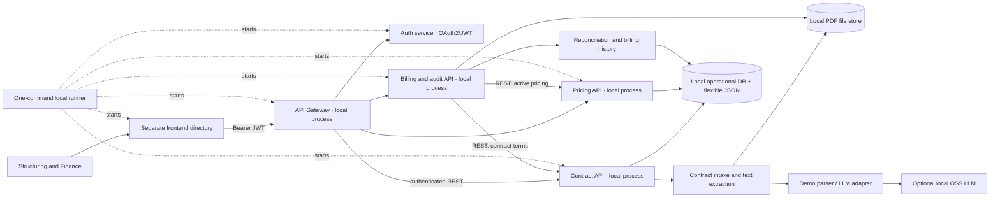
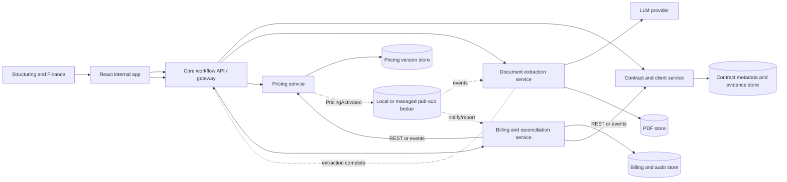
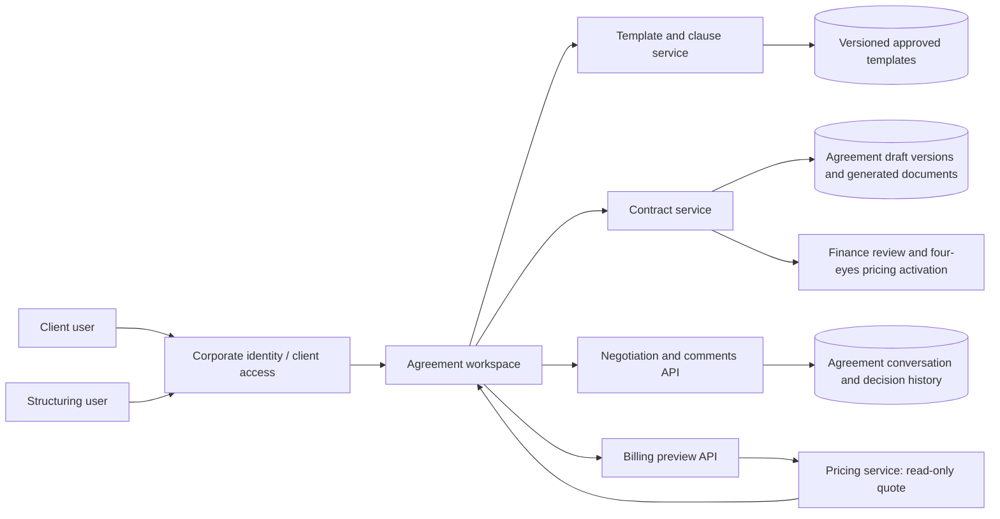
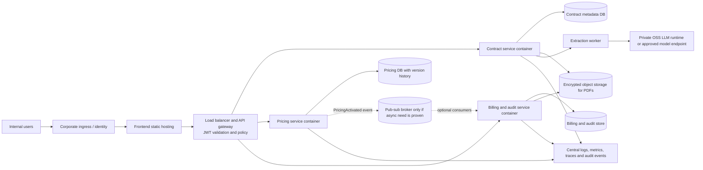

# Architecture Options

**Project:** Apollo / Wheels contract-to-pricing and billing audit MVP  
**Status:** Option A is the working direction for the first implementation. The frontend and backend services have separate directories and run as separate local processes; a single local command starts them all. Option B remains a valid future topology. Data storage is an open decision; do not treat SQL as an approved requirement until the comparison below is reviewed.

## Context and requirements that shape the choice

- Internal MVP for Structuring and Finance users.
- Both contract-to-approved-pricing and billing-PDF audit/history workflows are in scope; build sequentially.
- All 13 contract services are in scope.
- MSA and MLA are separate agreements linked to one client. Lease and service billing must remain identifiable and may be generated separately or combined.
- Structuring edits extracted agreement details. Finance enters pricing; one Finance user initiates and a different Finance user approves. Approval automatically activates the pricing.
- Approved pricing must persist in an internal database and be visible internally.
- Synthetic contract and billing documents are selectable-text PDFs in the MVP. OCR for scanned PDFs and client-facing pricing PDF/email delivery are later roadmap capabilities.
- Current implementation recommendation: Python/FastAPI services and a separate frontend directory. The local frontend can use a simple static server; framework choice remains open. The database/document-store choice is reviewed below.

## Option A — Local-first service modules with REST APIs

### Shape

Use a monorepo with separate frontend, Auth, API Gateway, Contract API, Pricing API, and Billing/Audit API directories. Each backend has its own entrypoint and can run separately on the developer machine. They communicate over authenticated REST for this MVP. A local runner starts all processes in the right order with one command. After the first MVP leg, service-owned business databases and independent deployment can be introduced without reorganizing the source tree.

### Why recommend it for the first MVP

- The code layout already matches future service boundaries, avoiding a source-tree rewrite.
- Auth issues human and client-credentials tokens; a local gateway gives the browser one authenticated entry point, while services repeat token validation and enforce roles/scopes.
- A one-command runner keeps the local demo simple while each service remains independently runnable.
- Service communication is easy to inspect and debug; no broker is needed for the current sequential workflows.
- The first leg can prove the pricing approval/activation flow before document and billing services scale independently.

### Trade-offs

- The local services still need coordinated configuration, startup order, logs, and timeouts.
- REST calls can fail, so useful failure states and bounded retries are needed.
- A shared local database/file store may simplify the demo; production deployments should move to service-owned storage where required.

## Option B — Independently Deployed Services

### Shape

Deploy independently scalable services with explicit APIs and service-owned persistence. Use asynchronous events for long-running extraction and approval notifications where eventual consistency is acceptable. A broker could be Kafka/Redpanda, RabbitMQ, or another locally runnable option selected after environment review. This does **not** mean one microservice per listed Wheels service; the 13 items are catalogue entries handled by common contract and pricing capabilities.

### Why a team might choose it

- Pricing, extraction, and billing can be released, scaled, and operated independently.
- A failure or heavy workload in document extraction can be isolated from pricing and reporting.
- Separate teams can own well-defined capabilities and data.
- The service boundaries are closer to a mature production platform when operational capability is available.

### Costs and risks for this prototype

- More application skeletons, API contracts, configuration, local processes/containers, health checks, and logs must be built and maintained.
- Service-to-service calls add network failures, timeouts, retries, duplicate submission/idempotency concerns, and more error paths to demonstrate.
- Four-eyes approval and activation span workflow and pricing; coordinating state across independent databases requires careful design (for example, an outbox/event pattern or durable retryable command), not a simple local function call.
- Billing reconciliation needs contract and pricing data from multiple owners. Cross-service reporting can require APIs, replicated read models, or an event-driven data pipeline.
- Integration testing and local setup take more effort, which can reduce time available for the actual contract/billing behavior and the demo.

## Can we use independent services?

Yes. Option B is technically valid and may be right when independent teams, scale, availability, or release cadence justify its operational costs. Option A already runs separate local APIs and keeps the future service structure; its main difference is REST communication and simpler deployment/orchestration for the MVP. Pub-sub is a later option for workloads that benefit from async processing.

## Data storage options and rationale

The architecture should not put every source PDF or all extracted text into relational rows. A 16–20-page contract PDF belongs in document/object storage (a local file store for the MVP, object storage in a production deployment). The database stores its file key/path, client, agreement type/version, dates, status, and extracted facts/evidence needed by the workflows.

### What each kind of data needs

- **Client/agreement identity and workflow:** stable IDs, agreement versions, effective dates, role actions, and approval state. These are structured and need reliable relationships and updates.
- **Pricing:** each version has reusable common fields (client, service, charge component, charge kind, rate, unit, currency, effective dates, status, initiator, approver) plus potentially changing calculation-specific attributes. A new pricing type should not require a new database column for every optional field.
- **Billing:** source PDFs are files. Parsed billing lines are comparatively small, structured, and repeatedly queried by client, service, billing stream, and period to compare totals and show history.
- **Contract terms and evidence:** extracted service/lease terms can evolve and can vary by agreement. Preserve flexible JSON with references to source document/page/clause, alongside indexed keys needed for review and matching.
- **Audit findings:** need client/date/service filters and links to contract, pricing and billing evidence; retain structured comparison keys while allowing flexible explanatory detail.

### Compared storage approaches

| Approach | Fit for this problem | Advantages | Costs / reasons not to use alone |
|---|---|---|---|
| Relational SQL database for all records | Strong for client identity, agreements, approval workflow, versioned pricing, normalized billing lines, and audit indexes. PDFs remain in file/object storage, not SQL blobs. | Transactions support four-eyes activation; constraints/indexes help prevent invalid or duplicate records; joins and grouping make three-way reconciliation and period/service reports direct. SQLite is simple locally; PostgreSQL is a production candidate. | A rigid table-only design can require migrations when optional contract/pricing attributes evolve. Avoid one column for every pricing variation. Use a stable common schema plus a JSON/JSONB payload for variable terms. |
| Document database (e.g. MongoDB) for most domain data | Strong for variable agreement structures, extraction results, and pricing documents with changing attributes. | Flexible nested documents; fields can be added without table migrations; agreement and pricing records can be stored as self-contained objects. | Cross-document reconciliation, historical effective-date queries, unique active-price rules, and multi-record approval/activation need carefully designed indexes, transactions, and aggregation pipelines. Data duplication across contract/pricing/billing documents can drift. It is viable if flexible nested pricing is the dominant need and query patterns are deliberately designed. |
| Hybrid (recommended candidate) | File/object store for PDFs; relational operational store for identities, approvals, versioned pricing and normalized billing lines; JSON fields for variable terms/extraction payloads. A document DB/search index can be added if later volume or query needs justify it. | Avoids putting large PDFs in SQL; keeps high-value workflow and reconciliation fields indexed/consistent; accommodates new pricing/contract attributes in JSON; leaves an incremental path to specialized storage. | Requires a clear rule for which fields are indexed columns versus flexible JSON. Two storage systems (relational DB and document store) would add sync/ops complexity, so the first version can use SQL JSON support without adding Mongo. |

### Recommendation for the MVP data layer

Use a **hybrid data model** rather than “SQL for everything”: store PDFs in a file store, put stable identities/workflow/pricing/billing facts in a relational database, and keep variable extracted contract terms and pricing-specific attributes in JSON payloads. For a small local MVP, SQLite is a low-code relational implementation and can store JSON text; PostgreSQL JSONB is a stronger future production candidate. MongoDB remains a valid alternative if pricing structures prove substantially more variable than the current common fields can support.

This recommendation does **not** mean storing full agreements, full PDFs, or every paragraph in SQL. Nor should a new charge component require a table change: store one record per component with common fields and a terms JSON object for type-specific attributes. Add a relational column only when a field needs consistent validation, indexing, or frequent joins/reporting.

### Why this instead of SQL-only or Mongo-only

- A SQL-only document-in-row design would be inappropriate for the PDFs and too rigid if it models every pricing subtype as new columns. The hybrid avoids both.
- A Mongo-only design is possible, but the MVP has strong transactional workflow needs (second-person approval and activate-once), effective-dated pricing, and recurring relational comparisons. A relational operational core makes these initial rules easier to enforce and report. If later data shape or scale proves otherwise, service/repository boundaries allow a document store to be introduced.
- Neither SQL nor Mongo should be selected based only on a general belief that one is more scalable. Choose based on data shape, query patterns, consistency needs, document volume, and the operational environment.

## Working recommendation and migration path

1. Start with Option A: separate frontend and backend service directories, independently runnable local Contract/Pricing/Billing APIs, REST communication, and one runner command for the full demo.
2. Keep each service entrypoint and data-access module distinct. The MVP uses a shared local SQLite business database for ease, separate SQLite audit databases for each service, and a local PDF file store. Production can move to service-owned business databases/file stores when deployment boundaries require it.
3. Use REST for contract lookup, pricing setup/approval, and billing reconciliation in the MVP. Avoid Kafka for now; it adds a broker process and event consistency rules to a short local demo.
4. Add asynchronous pub-sub later when extraction latency, retries, throughput, or independent service operations justify it. Evaluate locally runnable brokers such as Redpanda/Kafka or RabbitMQ at that point.
5. Move toward Option B when independent scaling, ownership, availability, or release cadence provides enough value to justify broker operations and cross-service coordination.

### Code simplicity rule

Keep the code small and direct: one FastAPI entrypoint and domain module per service, a few shared utilities, simple request/response schemas, and plain frontend HTML/CSS/JavaScript. Prefer explicit functions over generic frameworks or deep abstraction layers. Add a new library, service, queue, or database only when a confirmed requirement needs it. Readability takes precedence over minifying source files.

## Environment configuration and one-command local run

- Keep environment-specific settings in separate files, such as local, test, and production examples. Commit only examples with placeholders; ignore actual local secrets/config overrides.
- Services should read their own prefixed settings (ports, database path/URL, document store path, API base URLs, LLM provider/model, timeouts, and log level).
- The local runner loads environment config, starts Auth, API Gateway, Contract, Pricing, Billing, and the frontend static server, reports local URLs, and stops all children on Ctrl+C. Browser API calls use the gateway; backend APIs validate tokens again.
- Local MVP default: REST between APIs. The runner can start the OSS LLM runtime separately only when configured; the deterministic synthetic parser remains available for a no-credential demo.
- Production deployment is not selected yet. A future diagram should show the load balancer/API gateway, service containers, managed storage, object storage, secrets, identity, OpenTelemetry observability, and an event broker only where async workflows justify it.

## Future-state deployment sketch

The MVP remains local-first. The following is a roadmap shape, not a commitment to a specific cloud or platform:

### Future agreement template and negotiation capabilities

The future client/Structuring workspace adds agreement lifecycle capabilities alongside (and before) Finance's pricing activation flow:

The workspace should version the template and proposed agreement terms,
persist comments/decisions against an agreement, and enforce per-client
authorization. Client go-ahead triggers document generation from the
selected template and accepted values; it must not be treated as legal
execution unless a later signing/legal-approval workflow establishes that.
The billing preview is informational, identifies the pricing version and
assumptions it used, and is not an invoice. Structuring owns agreement
editing and negotiation; Finance retains pricing ownership and independent
approval. Template governance, comment resolution, retention, signing, and
price changes during negotiation require product/security/legal decisions.

This is a roadmap addition only. It does not change the MVP's internal-only
manual upload workflow or add client access, negotiation, template editing,
document generation, or billing preview to the current implementation.

Production services should use OpenTelemetry SDKs for traces, metrics, and
structured logs, propagate trace context across gateway and REST boundaries,
and export OTLP to an OpenTelemetry Collector. The collector can route signals
to a Grafana stack or ELK, selected after retention, access, and operational
requirements are known. This is a future-state requirement only; do not add
telemetry packages or code to the current local demo yet. A CDN is not needed
for the internal API-heavy MVP; reassess only if future client-facing static
content warrants caching.

### Why these deployment locations

- **Frontend static hosting:** serves the internal UI close to the corporate access layer; it contains no authoritative pricing or contract data.
- **Contract, Pricing, Billing/Audit containers:** keep deployable services aligned with their code directories and data ownership. Pricing can have stricter approval/access controls; extraction and billing can scale independently if volume requires it.
- **Separate service stores:** contract metadata/evidence, pricing versions/approvals, and billing/audit facts have distinct owners. Use database technology suited to each query pattern; keep the source PDFs in encrypted object storage rather than relational blobs.
- **Private LLM/OCR runtime:** contracts may contain sensitive commercial terms. Process within approved boundaries; use a managed model only if legal/security/data-processing requirements permit it. A local open-source model is a candidate only after evaluating quality, latency, machine capacity, and operational cost.
- **Pub-sub broker:** add only when document extraction or downstream notifications need durable asynchronous processing, decoupled retries, or independent consumer scale. REST remains simpler for current approval and lookup calls.
- **Identity, secrets, telemetry:** production needs real identity and role enforcement, managed secrets, and traceable service/audit events; the demo role picker and local config are not production controls.

Authentication should use the corporate identity provider (OIDC/OAuth2, with MFA and lifecycle controls for internal users); APIs must verify tokens and enforce role/permission checks on every protected operation. Finance and Structuring are application roles, ideally mapped from managed identity-provider groups rather than self-selected client values. For the four-eyes control, persist the identity provider's immutable user subject for the initiator and approver, reject approval when those subjects match inside the Pricing service transaction, and audit both subjects and timestamps. Display names and role labels are not identity and must not be used to establish independence. If client users are later introduced, add client-scoped authorization and tenant isolation; internal role access must not imply client access. The local demo login recommendation and current header-based limitation are documented in [the high-level architecture](docs/HIGH_LEVEL_ARCHITECTURE.md).

### Local open-source LLM path

Keep the extraction provider small and provider-neutral. An optional Ollama HTTP path is now implemented for agreement fields; deterministic parsing remains the default. The user's local GPU is an NVIDIA GTX 1050 with 4 GB VRAM. Qwen3.5 4B quantized is the first local evaluation candidate, but its listed 3.3-4.0 GB package leaves little room for inference and it has not been run or measured on the user's agreements. Qwen3.5 9B is larger than available VRAM. Mistral Small 4 is Apache 2.0 and supports document understanding, but its 119B parameters make it unsuitable for this workstation. Do not download model weights automatically. See [docs/LLM_TRADEOFFS.md](docs/LLM_TRADEOFFS.md) for source links, the JSON/evidence contract, risks, and evaluation plan.

## Decision still to review

The user selected Option A and has clarified that the frontend and backend services must be separate directories, independently runnable locally, and orchestrated by one command. Use REST for the MVP unless the implementation demonstrates a clear need for a local broker. The hybrid storage approach remains a recommendation for review. The user is open to an open-source local LLM if it produces good results; model/runtime selection should account for local hardware and evaluation quality.

