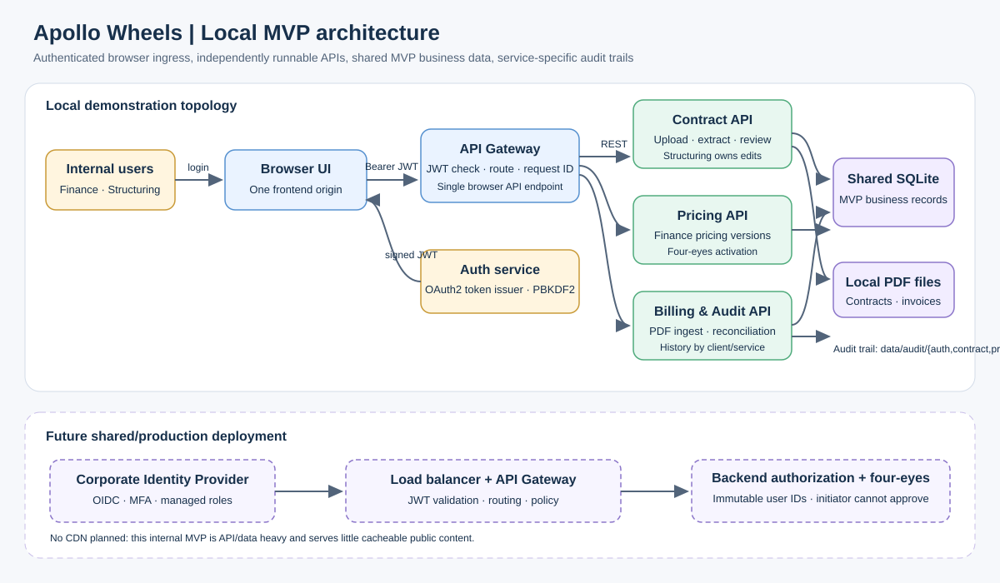
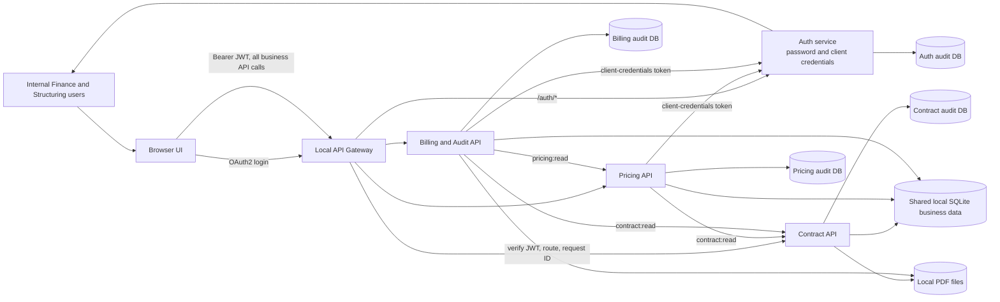
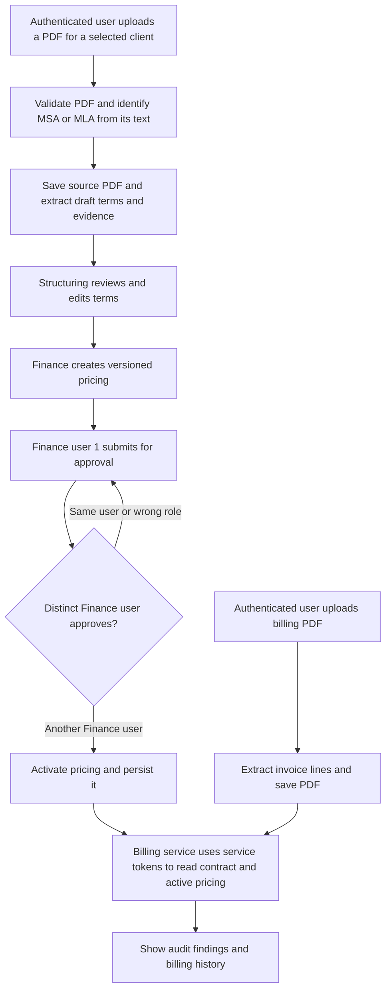
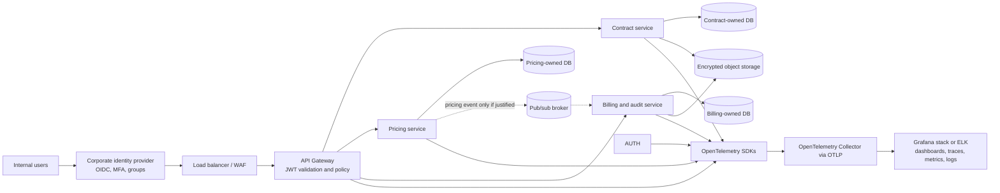

# High-Level Architecture

## MVP running locally

The one-command runner starts the frontend, Auth service, API Gateway, and Contract, Pricing, and Billing APIs as separate local processes. The browser gets one API base URL (the gateway). Human and service identity is issued by Auth; the gateway and each backend validate JWTs. Pricing and Billing use OAuth2 client-credentials tokens for their REST calls. Business data and PDF files remain shared local MVP stores. Audit logs are separate SQLite files per service under `data/audit/`.

The gateway protects every `/api/*` request. Health endpoints and the OAuth2 token endpoints are public by design; token endpoints require valid user credentials or client secrets. Each backend repeats JWT verification and role/scope authorization, so direct calls to a service port also require a valid token. The browser never sends role or user-ID headers.

### Main product workflow

## Authentication and authorization now

### Human demo users

The local demo has three accounts, stored in [demo_accounts.json](../config/demo_accounts.json) as salted PBKDF2 password hashes (never plaintext):

| Username | Role | Demo password | Stable user ID |
|---|---|---|---|
| `testfinance` | Finance | `FinanceDemo!2026` | `finance.alex` |
| `testfinance2` | Finance | `FinanceSecondDemo!2026` | `finance.jordan` |
| `teststructurer` | Structuring | `StructuringDemo!2026` | `structuring.lee` |

Use the first Finance account to create a pricing request, then sign in as the second Finance account to approve it. The server stores the authenticated subject and checks that the approver differs from the initiator. Changing the browser role, user name, or caller-supplied headers cannot change that subject.

### Service accounts

The local service clients are configured in the same account file with salted hashes, and their secrets are passed to each process through the ignored local environment file:

| Client ID | Local demo secret | Granted scopes | Used by |
|---|---|---|---|
| `pricing-service` | `pricing-demo-secret` | `contract:read` | Pricing API reads client/agreement records |
| `billing-service` | `billing-demo-secret` | `contract:read`, `pricing:read` | Billing API reconciles billing against contracts/prices |

Each service obtains a short-lived OAuth2 client-credentials token from Auth and sends it as a Bearer token to downstream APIs. Service tokens cannot perform user-only write actions or access Billing APIs. The backend scope checks limit service tokens to their declared reads.

### Auth, gateway, and backend responsibilities

- **Auth service:** active local password and client-credentials grants, salted PBKDF2 credential verification, signed 30-minute HS256 access tokens.
- **API Gateway:** the browser's single API entry point; checks JWTs, routes by API path, assigns/forwards a request ID, and returns upstream status/body.
- **Each backend:** validates the JWT again; enforces Finance/Structuring write permissions or service-account scopes. Role checks in the UI only control what is displayed and are not relied on for security.
- **Four-eyes pricing approval:** the Pricing service compares stable authenticated subject IDs in the approval operation; the initiating Finance user cannot approve their own request. The approval and initiator are retained with the pricing version.
- **Health and token endpoints:** health checks remain public for orchestration. Login and service-token endpoints are the only unauthenticated Auth routes and require credentials to issue tokens.

### Provider configuration

The Auth code has an `IdentityProvider` adapter boundary. `AUTH_PROVIDER=local` and `AUTH_LOCAL_DEMO_ENABLED=true` enable the local provider now. `AUTH_PROVIDER=oidc` and `AUTH_OIDC_ENABLED=true` select the corporate OIDC configuration adapter when issuer/client settings are provided. The OIDC authorization-code/callback flow and external-token/JWKS validation are a future implementation; selecting OIDC today reports that it is not implemented rather than silently falling back to local accounts. Settings live in environment-specific config templates, and the local/test examples select the local provider.

These credentials, the local signing secret, and shared local network ports are **demo-only**. Do not reuse them outside this local prototype. Tokens are kept in browser session storage for the demo. Production should use corporate OIDC authorization code with PKCE/MFA and a browser/backend session strategy that avoids exposing bearer tokens to JavaScript.

## Future deployment direction

Production authorization should map managed identity-provider groups/claims to application roles, enforce client/tenant scope if client users are added, and audit verified immutable subjects. For four-eyes approval, persist the identity provider's immutable subject as initiator and approver, reject matching subjects inside the Pricing approval transaction, and retain both identities/timestamps in the audit record. Names, emails, role labels, and client-supplied values are not valid independence checks. Keep service-to-service credentials in a managed secret store and use workload identities where the deployment platform supports them.

A load balancer and gateway belong in a shared deployment to distribute inbound traffic and centralize ingress policy; the local MVP uses one gateway process, so it does not need a separate load balancer. A CDN is not planned: this is an internal, API/data-heavy tool with little cacheable public content. Future storage, hosting, ingress vendors, and broker remain decisions rather than commitments.

Future observability should instrument the gateway and every API with OpenTelemetry so distributed traces, metrics, and structured logs share trace/request IDs. Export via OTLP to an OpenTelemetry Collector, then route to a selected Grafana stack (for example metrics/logs/traces backends) or ELK deployment. Define service dashboards, latency/error/throughput metrics, cross-service trace views, and alert rules before production rollout. This is an architecture requirement only; no OTel packages, exporters, collector, or telemetry code are added in the current local demo.
